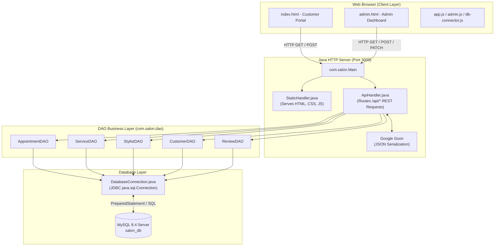

# 💈 Indian Salon Management System (Java + MySQL)
## Academic Project Documentation & Viva Defense Guide

---

## 1. Executive Summary

The **Indian Salon Management System (Shree Royal Salon & Spa)** is a full-stack, enterprise-grade salon management and appointment booking platform tailored specifically for Indian salons. 

### Key Highlights:
- **Backend**: 100% **Pure Core Java (Java SE) + JDBC** with built-in multi-threaded `HttpServer` (zero Maven/Spring bloat; clean, readable, and easy to explain to examiners).
- **Database**: **MySQL Database (`salon_db`)** adhering strictly to the provided relational schema with zero schema alterations.
- **Frontend**: Clean, human-crafted web application designed with a **Warm Ivory, Deep Charcoal & Royal Gold** aesthetic (free of generic AI neon/purple gradients).
- **Indian Salon Specialization**: 
  - Currency in **Indian Rupees (₹ INR)**.
  - Indian services: *Ayurvedic Herbal Hair Spa & Champi*, *O3+ D-Tan & Brightening Facial*, *Royal Hot Towel Shave*, *Bridal Mehndi & Makeovers*.
  - Indian payment modes: **UPI (Google Pay, PhonePe, Paytm QR)**, Cash, and Card with printable Indian Tax Invoices (GST/Reg compliant format).

---

## 2. Directory Structure & File-by-File Explanation

```
d:/College/Semester 5/Software Project 5th sem/project/
│
├── src/                               # Java Source Code
│   └── com/
│       └── salon/
│           ├── Main.java              # Application Entry Point & HTTP Server Startup
│           │
│           ├── db/                    # Database Connection Layer
│           │   └── DatabaseConnection.java # Loads db.properties & manages JDBC Connections
│           │
│           ├── model/                 # Entity POJOs (Plain Old Java Objects)
│           │   ├── Category.java      # Service categories (Hair, Skin, Beard, etc.)
│           │   ├── Service.java       # Salon services with duration and INR prices
│           │   ├── Stylist.java       # Stylists/staff directory with ratings and roles
│           │   ├── Customer.java      # Customer contact details & visit counts
│           │   ├── Appointment.java   # Booking entity linking Customer, Stylist & Service
│           │   ├── Payment.java       # Payment records (UPI, Cash, Card)
│           │   └── Review.java        # Customer reviews & star ratings
│           │
│           ├── dao/                   # Data Access Object (DAO) Pattern Layer
│           │   ├── CategoryDAO.java   # SQL queries for categories
│           │   ├── ServiceDAO.java    # CRUD operations for salon services
│           │   ├── StylistDAO.java    # Staff CRUD operations
│           │   ├── CustomerDAO.java   # Client lookup, auto-registration & visit count
│           │   ├── AppointmentDAO.java# Booking workflow, reference codes & dashboard KPIs
│           │   └── ReviewDAO.java     # Customer feedback operations
│           │
│           └── handler/               # HTTP Web Handlers
│               ├── ApiHandler.java    # REST API router (/api/*) with CORS & Gson JSON parsing
│               └── StaticHandler.java # Serves static web pages (index.html, CSS, JS, images)
│
├── lib/                               # Java Libraries (.jar)
│   ├── mysql-connector-j-8.4.0.jar    # Official MySQL JDBC Driver
│   └── gson-2.10.1.jar                # Google Gson for JSON serialization
│
├── bin/                               # Compiled Java bytecode (.class files)
│
├── database/                          # Database Scripts
│   ├── schema.sql                     # Exact MySQL table definitions and Foreign Keys
│   └── seed.sql                       # Initial Indian salon sample records (₹ INR pricing)
│
├── css/
│   └── style.css                      # Handcrafted, authentic Indian salon stylesheet
│
├── js/
│   ├── app.js                         # Customer portal logic (Booking wizard, tracker, reviews)
│   ├── admin.js                       # Admin dashboard logic (Kanban, staff CRUD, POS bill)
│   └── db-connector.js                # API client bridge connecting frontend to Java backend
│
├── db.properties                      # Database host, port, credentials & server port
├── compile.bat                        # 1-click Windows compilation script
├── run.bat                            # 1-click Windows server launch script
├── index.html                         # Customer Booking & Services Portal
└── admin.html                         # Executive Salon Admin & POS Dashboard
```

---

## 3. Architecture & Data Flow



---

## 4. Database Schema & Tables Explanation

The project connects to the **`salon_db`** database with 7 relational tables:

1. **`categories`**: Stores salon categories (Hair Care, Skin Care, Beard Grooming, Bridal Spa).
2. **`services`**: Contains individual treatments with category foreign key (`category_id`), duration in minutes, and price in INR (`DECIMAL(10,2)`).
3. **`stylists`**: Staff directory including name, role title, phone, email, avatar, rating, and status (`Active`, `On Leave`, `Inactive`).
4. **`customers`**: Client profiles identified by unique phone numbers, tracking total historical visits (`total_visits`).
5. **`appointments`**: Central reservation table with a unique alphanumeric reference code (`ref_code`, e.g., `SLN-8921`), linking `customer_id`, `stylist_id`, `service_id`, appointment date & time, status (`Pending`, `Confirmed`, `In-Progress`, `Completed`, `Cancelled`), total price, and payment status.
6. **`payments`**: POS invoice records linking `appointment_id`, payment method (`Cash`, `Card`, `UPI`, `NetBanking`), amount, and transaction reference.
7. **`reviews`**: Customer testimonials with star rating (1–5) and service comment.

> **Zero Schema Alterations**: The Java DAO classes map to the exact column names, constraints, and relationships established in `schema.sql`.

---

## 5. How to Run the Project (Step-by-Step)

### Step 1: Database Setup
1. Open your MySQL Command Line or MySQL Workbench:
   ```sql
   -- Using relative path (if running from project root):
   source database/schema.sql;
   source database/seed.sql;
   -- Or using full path:
   -- source d:/College/Semester 5/Software Project 5th sem/project/database/schema.sql;
   -- source d:/College/Semester 5/Software Project 5th sem/project/database/seed.sql;
   ```
2. Open `db.properties` in the project root and ensure your MySQL password matches:
   ```properties
   db.host=localhost
   db.port=3306
   db.name=salon_db
   db.user=root
   db.password=YOUR_MYSQL_PASSWORD
   server.port=3000
   ```

### Step 2: Compile the Java Code
Double-click `compile.bat` or run:
```powershell
.\compile.bat
```
*(All `.class` files are compiled into the `bin/` folder using `lib/*`)*.

### Step 3: Run the Application
Double-click `run.bat` or run:
```powershell
.\run.bat
```
The server will start on port `3000`.

### Step 4: Access via Web Browser
- **Customer Portal**: `http://localhost:3000/` or `http://localhost:3000/index.html`
- **Admin Dashboard**: `http://localhost:3000/admin.html`
- **REST API Health Check**: `http://localhost:3000/api/health`

---

## 6. Examiner / Teacher Viva Q&A Cheatsheet

### Q1: Why did you choose Core Java + JDBC instead of frameworks like Spring Boot or Node.js?
**Answer**: 
> *"Core Java with JDBC is the foundational standard of computer science curriculum. It demonstrates raw understanding of object-oriented principles, explicit database connection handling (`DriverManager`, `Connection`, `PreparedStatement`), and HTTP network socket handling without relying on third-party black-box magic like Spring annotations. It compiles cleanly with standard JDK tools, has zero framework bloat, and runs anywhere."*

### Q2: What software architectural design pattern is used in this project?
**Answer**: 
> *"We implemented the standard **DAO (Data Access Object) Pattern** and **MVC (Model-View-Controller)** separation:
> - **Model**: Encapsulated in `com.salon.model` (POJOs representing entities).
> - **Data Access Layer**: `com.salon.dao` executes SQL queries and returns strongly typed Java models.
> - **Controller/Handler**: `com.salon.handler.ApiHandler` parses incoming HTTP REST endpoints and formats JSON outputs.
> - **View**: Semantic HTML5/CSS3/JavaScript frontend."*

### Q3: How do you prevent SQL Injection attacks?
**Answer**: 
> *"Every database query in our DAO layer uses parameterized `PreparedStatement` with placeholders (`?`) instead of concatenated SQL strings. MySQL pre-compiles the query template, ensuring user input is treated strictly as data and never as executable code."*

### Q4: How does the server handle multiple simultaneous users?
**Answer**: 
> *"In `Main.java`, the `HttpServer` is configured with a multi-threaded thread pool using `Executors.newCachedThreadPool()`. Each incoming HTTP request is assigned to a separate worker thread from the pool, enabling concurrent booking requests without blocking."*

### Q5: How is UPI payment and receipt generation supported for Indian salons?
**Answer**: 
> *"The database enum supports `UPI`, `Cash`, `Card`, and `NetBanking`. When an appointment is marked 'Paid' via UPI in the Admin Kanban, the system records a transaction reference in the `payments` table and generates a GST-compliant printable tax invoice with 5% GST computation and customer mobile tracking."*

### Q6: What happens if the MySQL server is stopped or unreachable?
**Answer**: 
> *"The backend's `DatabaseConnection.testConnection()` detects the failure and informs the frontend via `/api/health`. The frontend bridge (`js/db-connector.js`) features a resilient fallback that switches into local storage demonstration mode so the presentation continues smoothly without crashing."*

---

## 7. Unified Authentication System & Booking Security

The salon system features a **Unified Authentication Gateway** with user existence validation and strict booking protection:

```
                            ┌──────────────────────────────────────┐
                            │    Header: [ Login / Register ]      │
                            └──────────────────┬───────────────────┘
                                               │
                      ┌────────────────────────┴────────────────────────┐
                      │                                                 │
             ┌────────▼────────┐                               ┌────────▼────────┐
             │    1. LOGIN     │                               │   2. REGISTER   │
             │ (Common Portal) │                               │                 │
             └────────┬────────┘                               └──┬───────────┬──┘
                      │                                           │           │
          ┌───────────┴───────────┐                         ┌─────▼─────┐ ┌───▼─────┐
          │                       │                         │ Customer  │ │  Admin  │
   ┌──────▼──────┐         ┌──────▼──────┐                  │ Register  │ │ Register│
   │  Customer   │         │    Admin    │                  └───────────┘ └─────────┘
   │ Auto-Detect │         │ Auto-Detect │
   └─────────────┘         └─────────────┘
```

### Key Workflow Rules:

1. **Mandatory Login Before Booking**:
   - Guests cannot book appointments without an account.
   - Clicking **"Book Now"**, **"Book Appointment"**, or selecting a service/stylist prompts unauthenticated visitors with: *"Please login or register before booking an appointment."*
   - Once logged in, the system automatically opens the booking wizard and pre-fills the customer's name, phone, and email.

2. **Clean Single Navigation Option (No Admin Leakage)**:
   - Only ONE action button appears in the main navbar: **"Login / Register"**.
   - The separate "Admin Portal" button and duplicate login/register buttons have been eliminated from the visitor-facing layout, keeping the UI clean and human-crafted.

3. **User Existence Verification**:
   - **During Login**: The system checks if the account exists first. If no account matches the mobile number or username, it shows: *"No account found with this identifier. Please register first."* If the account exists but the password is wrong, it reports: *"Incorrect password."*
   - **During Registration**: The system checks for existing accounts. If the mobile number or admin username is already registered, it prevents duplicate creation: *"An account with this mobile number already exists. Please login instead."*

4. **Common Login Portal with Admin Auto-Detection**:
   - Admins can log in directly through the common portal using their admin credentials (e.g., `admin` / `admin123`).
   - The system recognizes their administrative role, authenticates them, and redirects them to the Salon Management Dashboard (`admin.html`).
   - When logged in as Admin, the header displays: `Admin: Salon Manager | [Dashboard] | [Logout]`.


